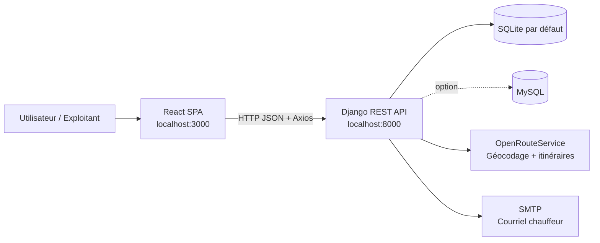

<div align="center">


# FleetWise

### Assistant intelligent de planification et de gestion du transport

Calculez des itinéraires adaptés aux poids lourds, estimez les coûts réels d'une mission et affectez-la à un chauffeur depuis une interface web moderne.

<p>
  
  
  
  
</p>

</div>

> **Projet en français — interface et messages applicatifs.**  
> FleetWise est une application complète destinée aux équipes d'exploitation qui souhaitent remplacer les estimations manuelles par des décisions de transport basées sur les données.

## 🧭 Sommaire

- [📌 Présentation](#présentation)
- [✨ Fonctionnalités](#fonctionnalités)
- [🖥️ Aperçu de l'interface](#aperçu-de-linterface)
- [🏗️ Architecture](#architecture)
- [🧰 Prérequis](#prérequis)
- [🚀 Installation locale](#installation-locale)
- [⚙️ Configuration](#configuration)
- [📖 Utilisation](#utilisation)
- [🔌 API REST](#api-rest)
- [🗃️ Modèle de données](#modèle-de-données)
- [📁 Structure du projet](#structure-du-projet)
- [🧪 Tests et qualité](#tests-et-qualité)
- [🌍 Déploiement](#déploiement)
- [🛠️ Dépannage](#dépannage)
- [🔒 Sécurité](#sécurité)
- [📄 Licence](#licence)

## 📌 Présentation

FleetWise réunit dans une seule application les outils essentiels à la préparation d'une mission :

1. saisir une ville de départ, une ville d'arrivée et un camion ;
2. géocoder les villes et récupérer une ou plusieurs routes via OpenRouteService ;
3. calculer la distance, la durée, le carburant, le coût chauffeur, les péages et le prix client ;
4. comparer les options et mettre en évidence l'itinéraire recommandé ;
5. affecter la mission à un chauffeur et lui envoyer les informations opérationnelles par courriel.

L'application propose deux espaces principaux :

- **Tableau de bord** : calcul et comparaison des itinéraires, puis affectation d'une mission ;
- **Administration** : gestion des camions, chauffeurs, péages et paramètres économiques.

## ✨ Fonctionnalités

### 🗺️ Analyse et optimisation des trajets

- Recherche de villes marocaines avec autocomplétion ;
- calcul d'itinéraires avec le profil poids lourd `driving-hgv` ;
- repli vers `driving-car` lorsque le profil poids lourd est refusé par le fournisseur ;
- routes alternatives pour les trajets courts (moins de 120 km) ;
- détection des portions d'autoroute et prise en compte des péages configurés ;
- score de recommandation combinant coût total et durée.

### 💰 Calcul économique

Pour chaque itinéraire, FleetWise estime notamment :

- la distance et la durée ;
- la consommation du camion ;
- le coût du carburant ;
- le coût horaire du chauffeur ;
- le péage éventuel ;
- le coût total, la marge et le prix client.

### 🚚 Gestion opérationnelle

- opérations CRUD complètes pour les camions ;
- opérations CRUD complètes pour les chauffeurs ;
- opérations CRUD complètes pour les tarifs de péage ;
- paramètres généraux centralisés : carburant, tarif horaire et marge ;
- assignation d'une route à un chauffeur ;
- courriel de mission contenant les informations opérationnelles, sans données financières.

## 🖥️ Aperçu de l'interface

Les visuels ci-dessous présentent les principaux écrans de FleetWise. Ils sont disponibles dans le dossier [`frontend/PLATFORM IMG`](frontend/PLATFORM%20IMG).

### 🧭 Architecture fonctionnelle

<div align="center">
  
  <p><em>Interactions entre le gestionnaire, le chauffeur, la base de données et OpenRouteService.</em></p>
</div>

### 📊 Tableau de bord et recherche d'itinéraire

<div align="center">
  
  <p><em>Formulaire de recherche avec villes de départ, d'arrivée et sélection du camion.</em></p>
</div>

<div align="center">
  
  <p><em>Autocomplétion des villes et lancement de l'analyse.</em></p>
</div>

### 💰 Résultats et analyse des coûts

<div align="center">
  
  <p><em>Comparaison des options, distance moyenne, durée moyenne et coût moyen.</em></p>
</div>

<div align="center">
  
  <p><em>Détail des coûts, prix de vente, bénéfice et affectation de la mission.</em></p>
</div>

### ⚙️ Administration

<div align="center">
  
  <p><em>Configuration du prix du carburant, du tarif chauffeur et de la marge.</em></p>
</div>

<div align="center">
  
  <p><em>Gestion de la flotte et de la consommation des camions.</em></p>
</div>

<div align="center">
  
  <p><em>Gestion des chauffeurs et de leurs adresses électroniques.</em></p>
</div>

<div align="center">
  
  <p><em>Référentiel des trajets et des tarifs de péage en MAD.</em></p>
</div>

### 🔄 Cycle de développement

<div align="center">
  
  <p><em>Analyse, conception, développement, tests et validation.</em></p>
</div>

### 🎨 Identité visuelle

<div align="center">
  
  <br>
  
</div>

L'interface utilise une bibliothèque interne d'icônes SVG inspirée de **Heroicons** pour garder une expérience cohérente et professionnelle :

| Icône | Utilisation dans l'application |
|---|---|
| 🚛 `truck` | Camions, flotte et identité FleetWise |
| 🗺️ `map`, `map-pin` | Itinéraires, villes et péages |
| 📊 `chart-bar`, `chart-bar-square` | Tableau de bord et recommandations |
| ⚙️ `cog` | Administration et paramètres |
| 👤 `user` | Chauffeurs et profil opérationnel |
| 💰 `currency-dollar`, `tag` | Analyse des coûts et tarification |
| ✈️ `paper-airplane` | Assignation et envoi d'une mission |
| ✅ `check`, `shield-check` | Confirmation et état sécurisé |

Les icônes sont centralisées dans [`Heroicons.js`](frontend/src/components/ui/Heroicons.js), ce qui facilite leur réutilisation dans les composants du tableau de bord et de l'administration.

## 🏗️ Architecture



### 🧱 Technologies

| Couche | Technologie | Rôle |
|---|---|---|
| Interface | React 19.1.1, Create React App | SPA responsive en français |
| Communication | Axios | Appels HTTP vers l'API |
| API | Django 4.2.16, Django REST Framework 3.14 | Points d'accès métier et opérations CRUD |
| Données | SQLite par défaut, PyMySQL disponible | Persistance locale ou serveur SQL |
| Cartographie | OpenRouteService | Géocodage et calcul des routes |
| Notifications | SMTP Django | Envoi des missions aux chauffeurs |
| Style | CSS maison et système de conception FleetWise | Interface du tableau de bord et administration |

## 🧰 Prérequis

- Python 3.9 ou supérieur ;
- Node.js 16 ou supérieur et npm ;
- une clé OpenRouteService pour le calcul réel des itinéraires ;
- un compte SMTP si l'envoi de courriels est utilisé ;
- MySQL 8+ uniquement si vous choisissez de remplacer SQLite.

## 🚀 Installation locale

### 1️⃣ Récupérer le projet

```bash
git clone <URL_DU_DEPOT>
cd transport_project
```

### 2️⃣ Installer le backend

#### Windows PowerShell

```powershell
cd backend
py -m venv venv
.\venv\Scripts\Activate.ps1
python -m pip install --upgrade pip
pip install -r requirements.txt
python manage.py migrate
python manage.py createsuperuser
python manage.py runserver
```

#### Linux / macOS

```bash
cd backend
python3 -m venv venv
source venv/bin/activate
python -m pip install --upgrade pip
pip install -r requirements.txt
python manage.py migrate
python manage.py createsuperuser
python manage.py runserver
```

Le backend est disponible sur <http://localhost:8000>.

> La configuration actuelle utilise `backend/db.sqlite3` par défaut. Il n'est donc pas nécessaire d'installer MySQL pour démarrer le projet en local.

### 3️⃣ Installer et lancer le frontend

Dans un second terminal :

```bash
cd frontend
npm install
npm start
```

Le frontend est disponible sur <http://localhost:3000>.

### 4️⃣ Vérifier la connexion

- API : <http://localhost:8000/api/status/>
- Santé du backend : <http://localhost:8000/api/health/>
- Interface : <http://localhost:3000>
- Administration Django : <http://localhost:8000/admin/>

Des scripts d'installation sont également présents à la racine :

- Windows : `setup_fleetwise.bat`
- Linux/macOS : `setup_fleetwise.sh`

Ils sont pratiques pour un démarrage guidé, mais la procédure manuelle ci-dessus est la référence et reflète la configuration SQLite actuelle.

## ⚙️ Configuration

### 🗺️ OpenRouteService

Le calcul des routes dépend d'OpenRouteService. Avant toute publication GitHub ou mise en production :

1. créez une clé sur <https://openrouteservice.org/dev/#/signup> ;
2. ne commitez jamais la clé dans le dépôt ;
3. déplacez-la dans une variable d'environnement et utilisez-la dans `backend/FleetWise/settings.py`.

Exemple PowerShell :

```powershell
$env:OPENROUTESERVICE_API_KEY = "votre-cle-api"
```

Exemple de configuration Django recommandée :

```python
import os

OPENROUTESERVICE_API_KEY = os.environ["OPENROUTESERVICE_API_KEY"]
OPENROUTESERVICE_BASE_URL = os.getenv(
    "OPENROUTESERVICE_BASE_URL",
    "https://api.openrouteservice.org",
)
```

### ✉️ Courriel SMTP

Pour activer l'envoi des missions, renseignez les paramètres SMTP dans la configuration Django ou via des variables d'environnement :

```python
EMAIL_HOST = "smtp.gmail.com"
EMAIL_PORT = 587
EMAIL_USE_TLS = True
EMAIL_HOST_USER = os.environ["EMAIL_HOST_USER"]
EMAIL_HOST_PASSWORD = os.environ["EMAIL_HOST_PASSWORD"]
DEFAULT_FROM_EMAIL = "FleetWise <noreply@fleetwise.ma>"
```

Avec Gmail, utilisez un **mot de passe d'application** et non le mot de passe principal du compte.

### 🗄️ MySQL (optionnel)

SQLite est le choix local par défaut. Pour un environnement partagé ou de production, configurez le bloc `DATABASES["default"]` avec le moteur MySQL, créez la base et exécutez ensuite :

```bash
python manage.py migrate
```

Le fichier `requirements.txt` contient déjà `PyMySQL`. La variable `MYSQL_DATABASE` présente dans les paramètres Django est un exemple de configuration ; elle ne devient active que si elle est affectée à `DATABASES["default"]`.

## 📖 Utilisation

### 🛠️ Première configuration

Depuis **Administration** :

1. définissez le prix du carburant en MAD/L ;
2. définissez le tarif horaire du chauffeur ;
3. définissez la marge par défaut, par exemple `0.200` pour 20 % ;
4. ajoutez les camions avec leur consommation en L/100 km ;
5. ajoutez les chauffeurs et leurs adresses électroniques ;
6. renseignez les trajets et tarifs de péage utiles.

### 🧭 Calculer une mission

1. ouvrez **Tableau de Bord** ;
2. sélectionnez la ville de départ et la ville d'arrivée ;
3. sélectionnez un camion ;
4. cliquez sur **Calculer les itinéraires** ;
5. comparez les routes, les durées et les coûts ;
6. choisissez **Assigner cette mission** sur la route retenue ;
7. sélectionnez un chauffeur, ajoutez éventuellement une note, puis confirmez.

Le courriel envoyé au chauffeur est opérationnel : itinéraire, distance, durée et notes. Les informations financières ne sont pas incluses dans ce courriel.

## 🔌 API REST

Base URL locale : `http://localhost:8000/api`

| Méthode | Endpoint | Description |
|---|---|---|
| `GET` | `/status/` | Vérifie que l'API répond |
| `GET` | `/health/` | Vérifie la santé du service |
| `GET` | `/cities/autocomplete/?q=Cas` | Propose des villes |
| `POST` | `/calculer-itineraire/` | Calcule et analyse les routes |
| `POST` | `/envoyer-mission/` | Envoie une mission par courriel |
| `GET`, `PUT`, `PATCH` | `/parametres/` | Lit ou modifie les paramètres singleton |
| `GET`, `POST` | `/camions/` | Liste ou crée des camions |
| `GET`, `PUT`, `DELETE` | `/camions/<id>/` | Gère un camion |
| `GET`, `POST` | `/chauffeurs/` | Liste ou crée des chauffeurs |
| `GET`, `PUT`, `DELETE` | `/chauffeurs/<id>/` | Gère un chauffeur |
| `GET`, `POST` | `/peages/` | Liste ou crée des péages |
| `GET`, `PUT`, `DELETE` | `/peages/<id>/` | Gère un péage |

### 🗺️ Exemple : calcul d'itinéraire

```bash
curl -X POST http://localhost:8000/api/calculer-itineraire/ ^
  -H "Content-Type: application/json" ^
  -d "{\"ville_depart\":\"Casablanca\",\"ville_arrivee\":\"Rabat\",\"camion_id\":1}"
```

Corps JSON attendu :

```json
{
  "ville_depart": "Casablanca",
  "ville_arrivee": "Rabat",
  "camion_id": 1
}
```

La réponse est une liste d'itinéraires contenant notamment `distance_km`, `duree_heures`, `cout_carburant`, `cout_chauffeur`, `cout_peage`, `cout_total`, `prix_client`, `score_recommandation` et `recommande`.

### ✉️ Exemple : envoyer une mission

```json
{
  "chauffeur_id": 1,
  "details_route": {
    "nom_itineraire": "Itinéraire recommandé",
    "distance_km": 92.4,
    "duree_formattee": "1 h 35"
  },
  "notes": "Départ à 08:00"
}
```

Les erreurs sont renvoyées avec un message `erreur` et un code HTTP adapté (`400` pour une requête invalide, `500` pour une erreur serveur).

## 🗃️ Modèle de données

| Modèle | Champs principaux | Utilité |
|---|---|---|
| `Camion` | `nom`, `consommation` | Décrit un véhicule et sa consommation |
| `Chauffeur` | `nom`, `email` | Stocke le destinataire des missions |
| `TrajetPeage` | `ville_depart`, `ville_arrivee`, `prix` | Référentiel interne des péages |
| `ParametresGeneraux` | `prix_carburant`, `tarif_horaire_chauffeur`, `marge_benefice_par_defaut` | Configuration économique singleton |

## 📁 Structure du projet

```text
transport_project/
├── backend/
│   ├── FleetWise/                 # Paramètres, URLs, ASGI et WSGI
│   ├── fleetWiseApp/
│   │   ├── models.py              # Modèles métier
│   │   ├── serializers.py         # Validation des requêtes/réponses
│   │   ├── services.py            # ORS, calcul des coûts et courriels
│   │   ├── views.py               # Points d'accès REST
│   │   ├── urls.py                # Routage API
│   │   └── management/commands/   # Commandes de préparation des données
│   ├── db.sqlite3                 # Base locale fournie
│   ├── manage.py
│   └── requirements.txt
├── frontend/
│   ├── public/                    # Manifeste, favicon et logos
│   └── src/
│       ├── components/
│       │   ├── dashboard/         # Recherche, résultats, carte et affectation
│       │   ├── admin/             # Paramètres, camions, chauffeurs et péages
│       │   └── ui/                # Icônes partagées
│       ├── pages/                 # DashboardPage et AdminPage
│       ├── services/api.js        # Client Axios centralisé
│       └── styles/                # Design system et styles métier
├── setup_fleetwise.bat
├── setup_fleetwise.sh
└── README.md
```

## 🧪 Tests et qualité

### 🐍 Backend

```bash
cd backend
python manage.py test
```

### ⚛️ Frontend

```bash
cd frontend
npm test
```

### 📦 Compilation de production de l'application React

```bash
cd frontend
npm run build
```

## 🌍 Déploiement

Avant de déployer :

- désactivez `DEBUG` ;
- utilisez une clé `SECRET_KEY` privée et générée ;
- configurez `ALLOWED_HOSTS` ;
- remplacez SQLite par une base persistante adaptée à l'environnement ;
- configurez les variables OpenRouteService et SMTP hors du code ;
- activez HTTPS et configurez CORS pour le domaine réel du frontend ;
- servez le frontend compilé avec un serveur web ;
- lancez Django avec Gunicorn ou uWSGI derrière Nginx ;
- appliquez `python manage.py migrate` sur la base de production.

## 🛠️ Dépannage

| Symptôme | Vérifications |
|---|---|
| Le frontend indique « API Déconnectée » | Vérifiez `python manage.py runserver`, puis ouvrez `/api/status/` |
| Erreur CORS | Vérifiez l'origine du frontend dans `CORS_ALLOWED_ORIGINS` |
| Aucun itinéraire | Vérifiez la clé OpenRouteService, la connexion internet et les noms de villes |
| Courriel non envoyé | Vérifiez SMTP, le mot de passe d'application et les journaux Django |
| Erreur de migration | Activez l'environnement virtuel et exécutez `python manage.py migrate` |
| Les coûts semblent incorrects | Contrôlez les paramètres généraux, la consommation du camion et les péages |

## 🔒 Sécurité

La configuration de développement contient des valeurs qui ne doivent **pas** être utilisées en production. Avant de publier ce projet sur GitHub :

- révoquez et remplacez toute clé OpenRouteService déjà exposée ;
- retirez les secrets et mots de passe de `settings.py` ;
- utilisez des variables d'environnement ou un gestionnaire de secrets ;
- ne publiez pas `db.sqlite3` si elle contient des données métier ou personnelles ;
- ajoutez un fichier `.gitignore` couvrant `venv/`, `.env`, `__pycache__/`, `node_modules/` et les bases locales ;
- ajoutez une authentification et des permissions adaptées avant une exposition publique : l'API actuelle utilise `AllowAny` pour le développement.

## 📄 Licence

Aucune licence open source n'est déclarée pour le moment. Le projet est indiqué comme destiné à un usage interne d'entreprise de transport. Ajoutez un fichier `LICENSE` avant toute redistribution publique.

---

<div align="center">

**FleetWise** · Solution intelligente de gestion du transport

Développé avec Django, Django REST Framework et React.

</div>
